<div align="center">


<br/>

<p align="center">
  <a href="https://git.io/typing-svg"></a>
</p>

<p align="center">
  <a href="https://portofolio-v2-one-gray.vercel.app/" target="_blank"></a>
  <a href="https://linkedin.com/in/ridhotawang" target="_blank"></a>
  <a href="https://t.me/lavenderpoet608" target="_blank"></a>
  <a href="mailto:lavenderpoet607@gmail.com"></a>
  <a href="https://wa.me/6281311685803" target="_blank"></a>
</p>

</div>

---

### 👨‍💻 About Me

```yaml
identity:
  name: "Ridho Tawang (Ridho D. T)"
  handle: "@lavenderpoet607"
  motto: "Make it possible"
  location: "Indonesia"
focus:
  - "Building cross-platform mobile apps with Flutter (60–120 FPS & Clean Architecture)"
  - "Designing responsive full-stack web applications with modern frontend & scalable backends"
  - "Low-level system engineering, reverse engineering (C/C++, IDA Pro, IL2CPP), and MCP tooling"
availability: "Open for freelance, contract, or full-time opportunities"
```

- 🚀 **Currently Building:** AI agents, cross-platform solutions, and developer tooling bridging low-level workflows into modern agentic ecosystems.
- 🎯 **Specialization:** Cross-Platform Mobile Apps, Full-Stack Web Development, Systems Architecture, and API integrations.
- ⚡ **Core Philosophy:** Clean architecture, pixel-perfect UI/UX, deterministic data flows, and zero bloat.

---

### 🛠️ Tech Stack & Arsenal

<table>
  <tr>
    <td align="center" width="160"><b>Mobile</b></td>
    <td>
      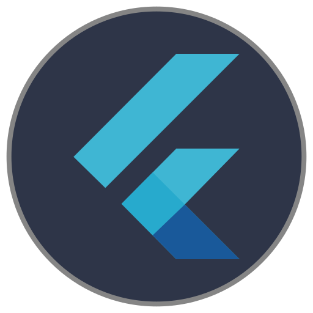
      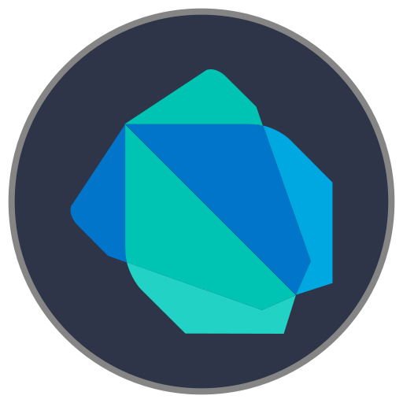
      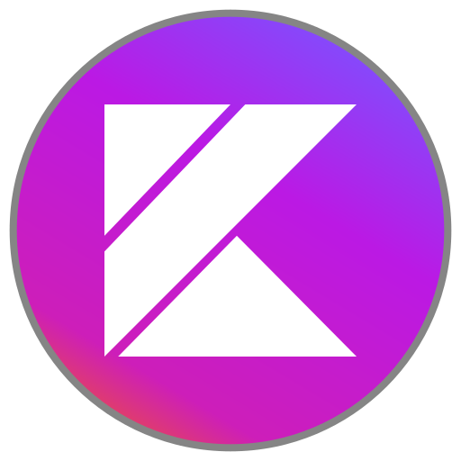
      
    </td>
  </tr>
  <tr>
    <td align="center"><b>Frontend &amp; Web</b></td>
    <td>
      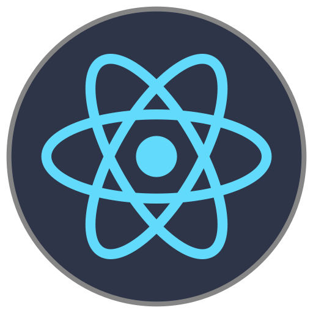
      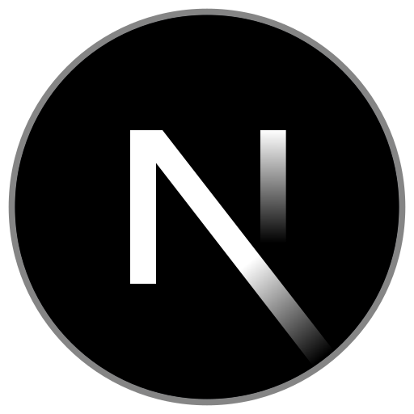
      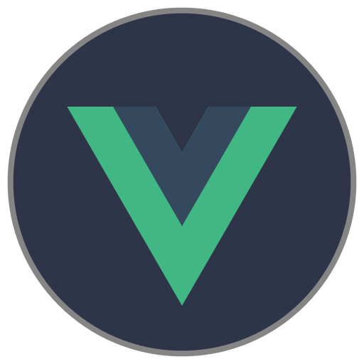
      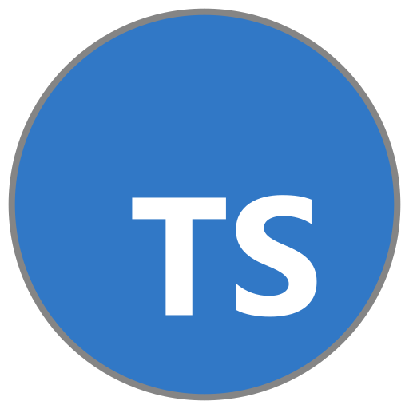
      
      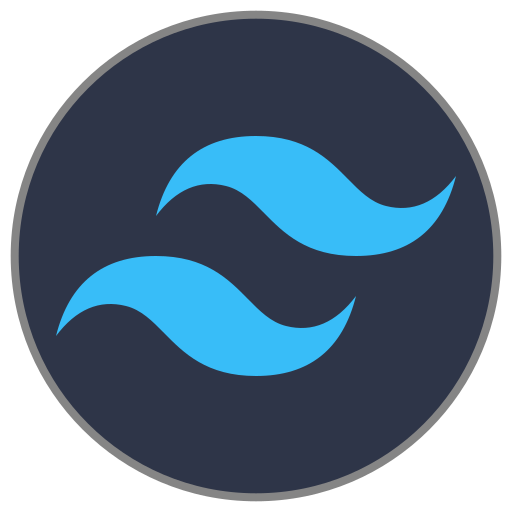
      
      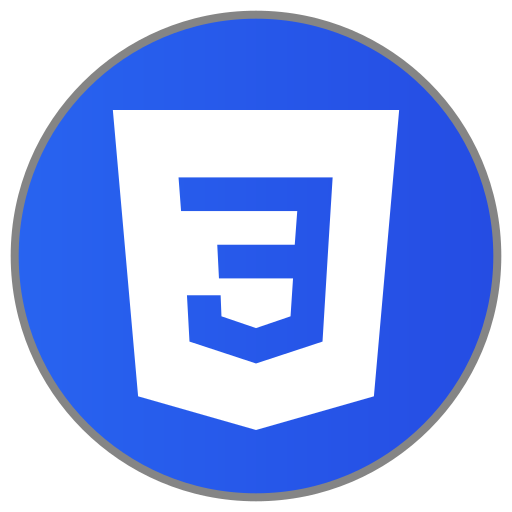
    </td>
  </tr>
  <tr>
    <td align="center"><b>Backend &amp; Cloud</b></td>
    <td>
      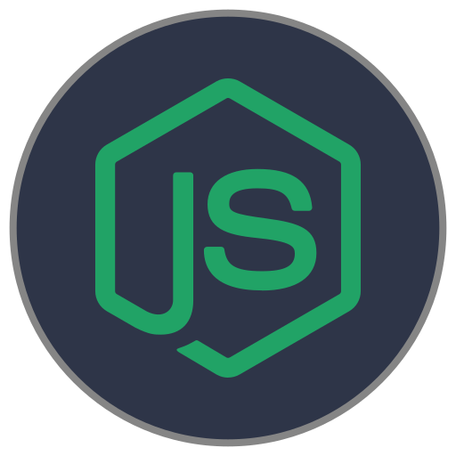
      
      
      
      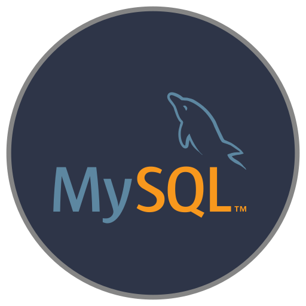
      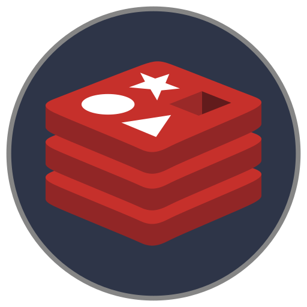
      
    </td>
  </tr>
  <tr>
    <td align="center"><b>Systems &amp; Low-Level</b></td>
    <td>
      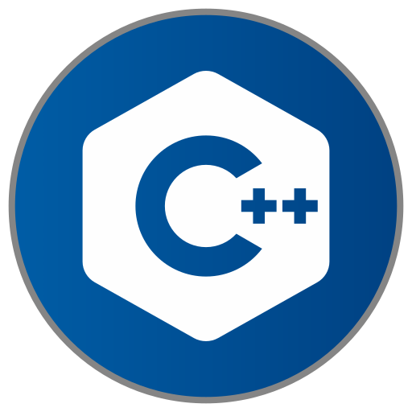
      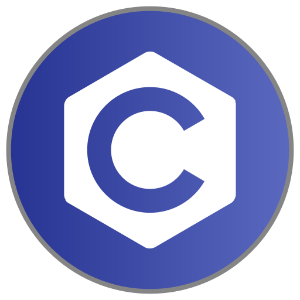
      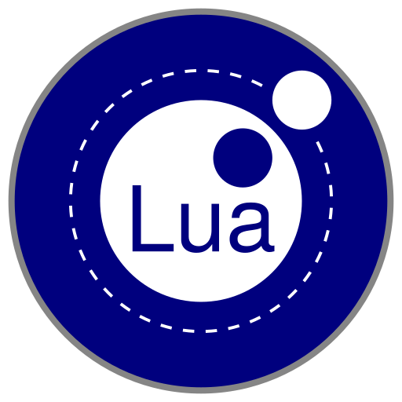
      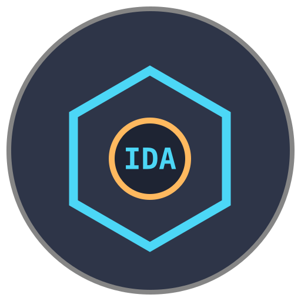
      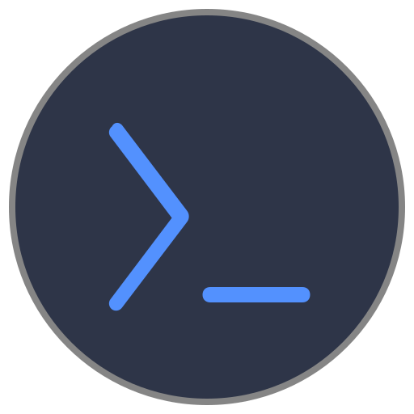
      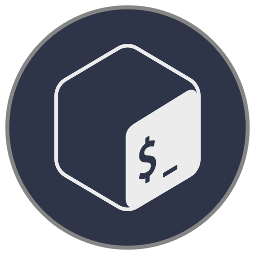
      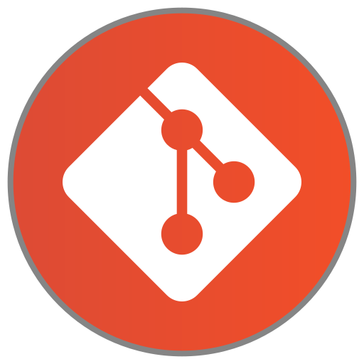
      
      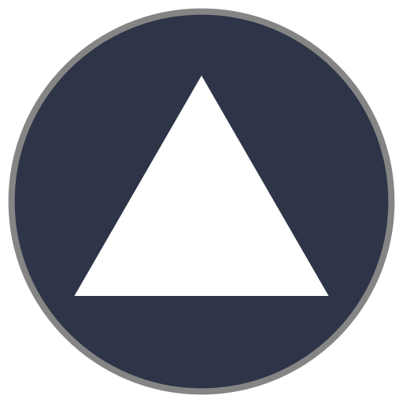
    </td>
  </tr>
</table>

---

### 🌟 Featured Highlights & Repositories

| Repository | Focus & Highlights |
| :--- | :--- |
| **[ida_mcp_agent](https://github.com/lavenderpoet607/ida_mcp_agent)** | IDA Pro & ReClass.NET Model Context Protocol (MCP) server bridge with PowerShell auto-installer. |
| **[anti-slop](https://github.com/lavenderpoet607/anti-slop)** | Production-ready guidelines and filters for AI coding agents to eliminate generic slop and maintain human-grade code quality. |
| **[ICONIC](https://github.com/lavenderpoet607/ICONIC)** | Developer-oriented library of sleek, bubble-shaped skill icons designed for GitHub profiles and portfolios. |
| **[ResoNime](https://github.com/lavenderpoet607/ResoNime)** | Mobile anime media portal with modern Flutter UI, state management, and smooth responsive interaction. |
| **[portofolio-V2](https://github.com/lavenderpoet607/portofolio-V2)** | Personal developer portfolio crafted with Bento Glass aesthetic, CSS glassmorphism, and responsive interactions. |

---

### 📊 GitHub Analytics

<div align="center">
  <table border="0">
    <tr>
      <td>
        
      </td>
      <td>
        
      </td>
    </tr>
  </table>

  <br/>

  
</div>

---

### 🤝 Connect & Collaborate

<p align="center">
  I am always open to discussing new projects, software architecture, mobile engineering, and creative ideas.
  <br/><br/>
  <a href="https://portofolio-v2-one-gray.vercel.app/">🌐 Website</a> •
  <a href="https://linkedin.com/in/ridhotawang">💼 LinkedIn</a> •
  <a href="https://t.me/lavenderpoet608">✈️ Telegram</a> •
  <a href="mailto:lavenderpoet607@gmail.com">📬 Email</a> •
  <a href="https://wa.me/6281311685803">💬 WhatsApp</a>
</p>

<div align="center">
  
</div>
